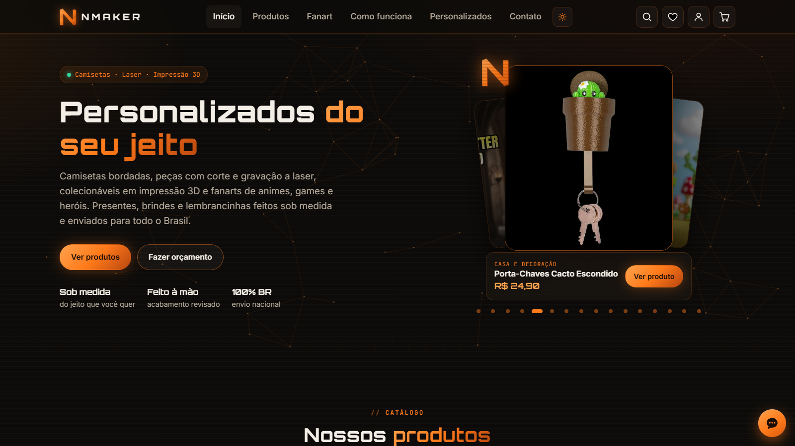
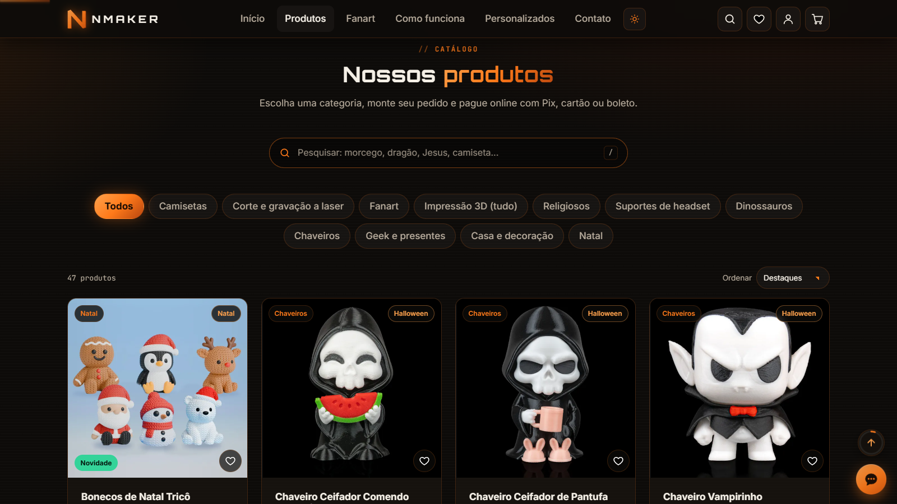
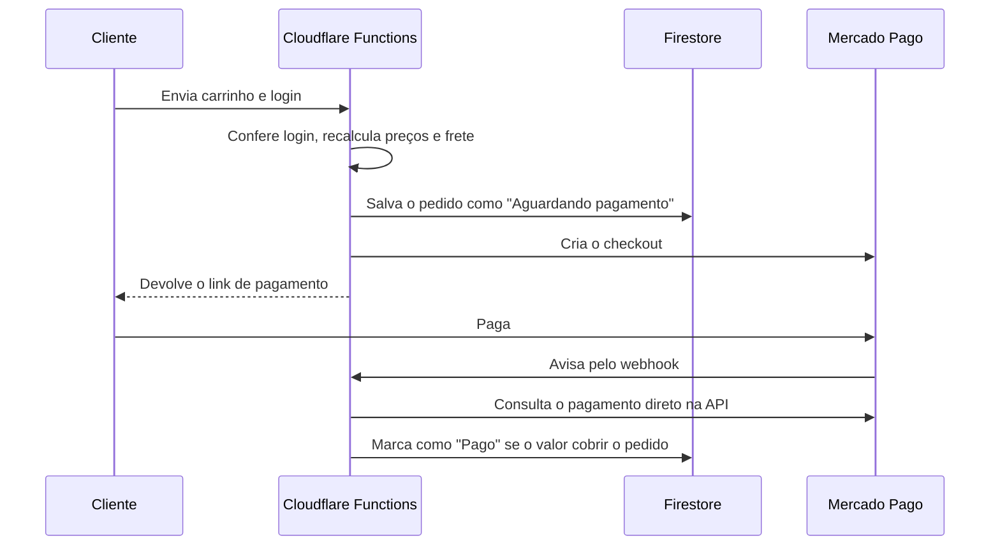

# NMAKER — loja virtual completa, do catálogo ao pagamento

Loja virtual em produção da **NMAKER**, que vende camisetas bordadas, peças com corte e gravação a laser e impressão 3D, com envio para todo o Brasil.

O projeto cobre o fluxo inteiro de um e-commerce: catálogo com mais de 250 produtos, contas de cliente, pagamento online, confirmação automática, chat em tempo real e painel da loja. Tudo com JavaScript puro, sem framework.

**[Ver o site no ar →](https://nmaker.com.br)** · **[Ver a apresentação em PDF →](prints-portfolio/linkedin/NMAKER-portfolio.pdf)**





## Tecnologias

| Área | Tecnologia |
|---|---|
| Interface | HTML, CSS e JavaScript puros |
| Back-end | Cloudflare Pages Functions |
| Login e banco de dados | Firebase Auth e Firestore |
| Pagamentos | Mercado Pago (Pix, cartão e boleto) |
| Hospedagem e DNS | Cloudflare Pages |
| Automação | Scripts em Node.js e Python |

## Principais funcionalidades

**Para o cliente**
- Catálogo com busca, categorias, ordenação e galeria de fotos
- Produtos com variações de acabamento e tamanho
- Carrinho, frete por região e pagamento pelo Mercado Pago
- Cadastro, login com e-mail ou Google, histórico de pedidos e favoritos
- Chat com a loja dentro do site, sem precisar do WhatsApp
- Layout para celular e computador, com tema claro e escuro

**Para a loja**
- Painel com pedidos em tempo real, gráfico de vendas e mudança de status
- Lista de clientes e central de conversas
- Pedido marcado como pago automaticamente quando o pagamento é aprovado

## Como o pagamento funciona

O navegador nunca decide o valor cobrado, e o aviso de pagamento nunca é aceito sem conferência.



## Decisões de segurança

- **Preços no servidor:** o catálogo usado na cobrança é gerado no build, e os valores enviados pelo navegador são ignorados.
- **Webhook que não confia no aviso:** o status e o valor vêm sempre da API do Mercado Pago. Pagamentos de teste são ignorados com a loja em produção.
- **Regras do Firestore:** cada cliente lê apenas os próprios dados, e pedidos só podem ser criados pelo servidor.
- **Login verificado no servidor:** o token do Firebase é conferido por assinatura, emissor e projeto.
- **Cabeçalhos de segurança:** CSP, HSTS e proteção contra uso em iframes, com regras mais rígidas no painel.
- **Segredos fora do código:** as chaves ficam só nas variáveis secretas do Cloudflare.

## Estrutura

```
site/               o site (index.html, admin.html, js/, imagens/, dados/)
functions/api/      Cloudflare Pages Functions (criar-pagamento, webhook-mercadopago)
servidor/           regras do pedido, frete, catálogo e acesso ao Firebase
scripts/            geração do catálogo e das fanarts, testes e publicação
prints-portfolio/   telas e apresentação do projeto
firestore.rules     regras de segurança do Firestore
wrangler.toml       configuração do Cloudflare Pages
```

As regras de negócio ficam separadas em `servidor/`, para poderem ser testadas no computador, sem chaves e sem internet.

## Como rodar

```bash
npm install

# configuração do Firebase: copie o exemplo e preencha com o seu projeto
cp site/js/config.exemplo.js site/js/config.js

# testes das regras de pagamento (não precisam de chaves)
npm run testar

# gera o catálogo do servidor a partir do site
npm run build

# publica no Cloudflare Pages
npx wrangler pages deploy site --project-name nmaker
```

Para os pagamentos funcionarem, configure estas variáveis secretas no Cloudflare:

| Variável | Para que serve |
|---|---|
| `MP_ACCESS_TOKEN` | Credencial do Mercado Pago |
| `FIREBASE_SERVICE_ACCOUNT` | Conta de serviço do Firebase, usada só pelo servidor |
| `MP_WEBHOOK_SECRET` | Opcional: confere a assinatura dos avisos do Mercado Pago |

## Autor

Desenvolvido por [Niozin101](https://github.com/Niozin101).
